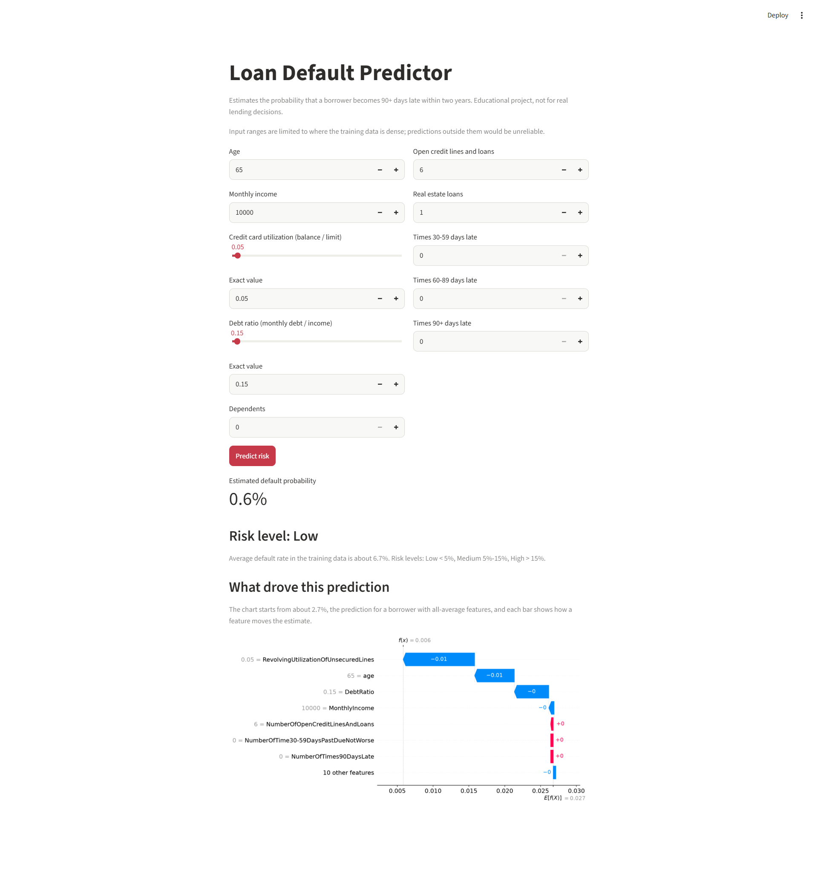
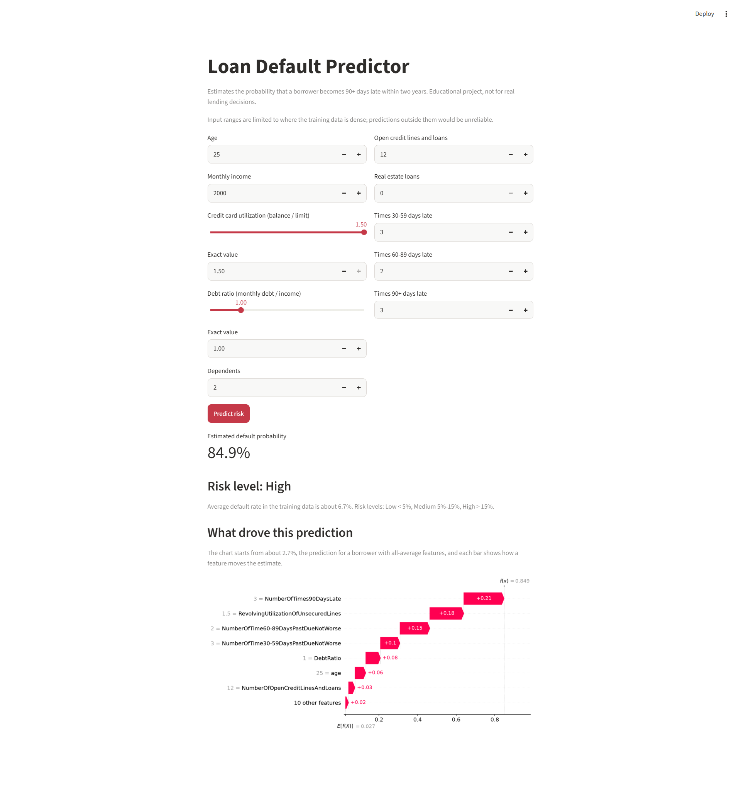
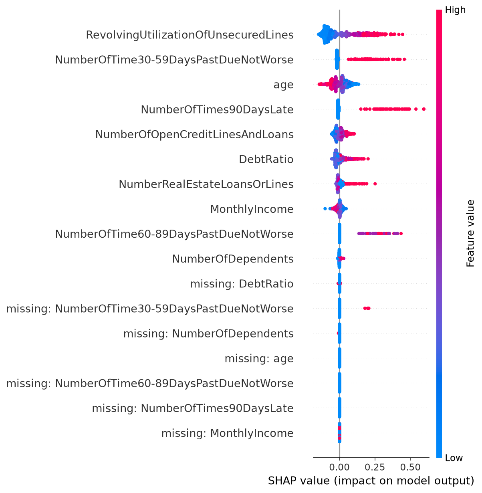
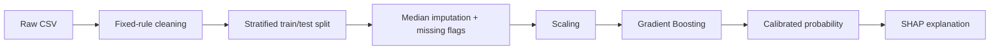

# Loan Default Predictor

Estimates the probability that a borrower becomes 90+ days late on a loan within two years, using a leakage-free scikit-learn pipeline, calibrated probabilities, and SHAP explanations for every prediction.

| Safe borrower | Risky borrower |
|---|---|
|  |  |

## Why this project

Only 6.7% of borrowers in the data default, so accuracy is a misleading metric (always predicting "no default" scores 93%). This project focuses on what matters in credit risk: ranking quality (ROC-AUC, PR-AUC), **well-calibrated probabilities**, and **explaining each decision**.

## Results

Data: Kaggle *Give Me Some Credit* (150,000 borrowers, 6.68% default rate). 80/20 stratified split. All model selection used 5-fold stratified cross-validation on the training set only.

**Model comparison (cross-validation)**

| Model | ROC-AUC | PR-AUC |
|---|---|---|
| Gradient Boosting (class weights) | 0.8633 | 0.3937 |
| Random Forest (class weights) | 0.8555 | 0.3798 |
| Logistic Regression (class weights) | 0.8546 | 0.3806 |
| Logistic Regression + SMOTE | 0.8537 | 0.3795 |
| Gradient Boosting + SMOTE | 0.8535 | 0.3613 |

Class weights beat SMOTE for ranking. Hyperparameter tuning (randomized search) raised the CV ROC-AUC to 0.8644, a gain within fold-to-fold noise.

**Calibration was the deciding factor.** Class weights inflate predicted probabilities (Brier score 0.143), which makes the outputs meaningless as risk percentages. The final model is the tuned Gradient Boosting model **retrained without class weights**: ranking stayed the same and the probabilities became calibrated (Brier 0.049).

**Held-out test set (final model)**

| Metric | Value |
|---|---|
| ROC-AUC | 0.868 |
| PR-AUC | 0.409 (no-skill baseline 0.067) |
| Brier score | 0.049 |

**Calibration check on the test set (predicted vs actual default rate, by decile)**

| Decile | Predicted | Actual |
|---|---|---|
| Lowest risk | 0.6% | 0.3% |
| 5th | 1.9% | 1.8% |
| 8th | 6.6% | 7.1% |
| 9th | 11.5% | 11.9% |
| Highest risk | 36.1% | 36.9% |

**Thresholds used by the app's risk levels**

| Cutoff | Borrowers flagged | Precision | Recall |
|---|---|---|---|
| 5% (Medium or High) | 30.7% | 18.4% | 84.2% |
| 15% (High) | 11.1% | 35.2% | 58.3% |
| 30% | 5.7% | 46.9% | 40.2% |

The right cutoff depends on the cost of a missed default versus a rejected good borrower.

## Explainability

SHAP values explain each prediction. The app shows a waterfall chart with the borrower's real values.



Past-due counts and credit utilization are among the strongest risk drivers, and higher age lowers risk.

## Pipeline



Cleaning uses fixed rules only (no statistics learned from the data). The imputer and scaler are fitted inside the scikit-learn `Pipeline`, so every cross-validation fold fits them on its own training data and nothing leaks.

Data-quality findings from the EDA that drive the cleaning step:
- Values 96 and 98 in the late-payment columns are placeholder codes, so they are treated as missing.
- 93% of rows with DebtRatio > 10 have missing income, so DebtRatio is treated as missing there and a missing-income indicator is added.
- Extreme utilization, debt ratio and income values are capped at fixed thresholds.

## Tech stack

Python, pandas, NumPy, scikit-learn, imbalanced-learn, SHAP, Streamlit, Matplotlib

## Project structure

```
loan-default-predictor/
├── app/streamlit_app.py      # Streamlit app
├── notebooks/
│   ├── 01_eda.ipynb          # Exploratory data analysis
│   ├── 02_modeling.ipynb     # Models, SMOTE, tuning, test evaluation, calibration
│   └── 03_explainability.ipynb  # SHAP
├── src/preprocessing.py      # Cleaning, split, preprocessing pipeline
├── tests/                    # pytest suite (preprocessing rules, saved model)
│   ├── test_preprocessing.py
│   └── test_model.py
├── models/                   # Trained pipeline (joblib)
├── reports/                  # Plots and screenshots
├── data/raw/                 # Dataset goes here (not included)
├── requirements.txt          # Runtime dependencies
└── requirements-dev.txt      # Extra packages for the notebooks
```

## Run it locally

```bash
git clone https://github.com/Aliza-Shahid/loan-default-predictor.git
cd loan-default-predictor
python -m venv venv
venv\Scripts\activate        # macOS/Linux: source venv/bin/activate
pip install -r requirements.txt
streamlit run app/streamlit_app.py
```

The trained model is included, so the app runs without the dataset.

## Run the tests

```bash
pip install -r requirements-dev.txt
python -m pytest tests/ -v
```

The suite checks the cleaning rules (placeholder codes, impossible ages,
debt-ratio handling, value caps), that the split stays stratified, that the
preprocessor output has no missing values, and that the saved model is the
calibrated unweighted model with sane predictions (low risk for a safe
borrower, high risk for a risky one, higher utilization raising risk).

**To reproduce the notebooks:** download `cs-training.csv` from the [Kaggle competition](https://www.kaggle.com/c/GiveMeSomeCredit) (accept the rules first), place it in `data/raw/`, run `pip install -r requirements-dev.txt`, and run the notebooks in order.

## Limitations

- Educational project, not for real lending decisions.
- The data is from a 2011 Kaggle competition and may not reflect current borrowers.
- The model uses age as a feature. In real lending, using age is restricted in many places, and a production system would need a fairness review.
- Predictions are only reliable where the training data is dense, so the app limits inputs to age 18-90, income 500-50,000, utilization 0-1.5 and debt ratio 0-5. At the edges of the original ranges the model was not monotonic (for example, utilization 2.0 scored slightly below 1.0).
- The tuned hyperparameters were selected with a class-weighted model and reused for the final unweighted model.

## Future improvements

- Monotonic constraints so risk never decreases as utilization, debt ratio or late payments rise.
- Probability calibration with isotonic regression as a comparison.
- Fairness analysis across age groups.

## Dataset

[Give Me Some Credit](https://www.kaggle.com/c/GiveMeSomeCredit), used under the competition rules.